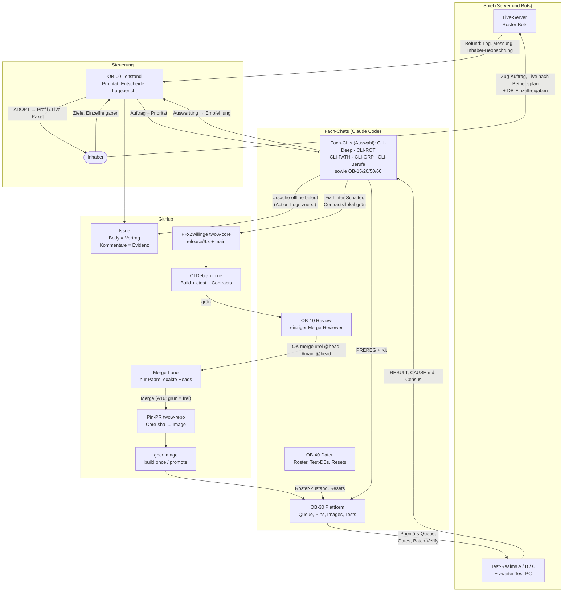
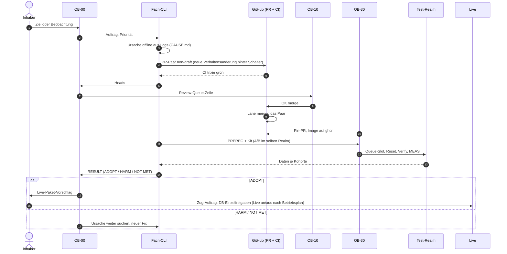

# Claude ↔ GitHub ↔ Spiel: Arbeitsablauf

Stand 28.10.2026. Das Bild zeigt, wie die Claude-Chats über GitHub zusammenarbeiten
und wie ein Fix vom Befund im Spiel bis auf den Live-Server kommt.
Maßgeblich bleiben das lokale Arbeits-Overlay (AGENTS.md, Ä12–Ä17) und ADR-0031.

## Gesamtablauf

## Ein Fix im Detail

## Regeln in einem Satz

- Neue Verhaltensänderungen mit offenem Nutzen kommen hinter Schaltern (Default 0) und gehen erst nach einem A/B-Nachweis ins Profil; angenommene Bug-Fixes laufen mit Default 1 (z. B. #752, #756).
- Merge nur bei grüner CI und OB-10-OK auf den exakten Heads; twow-core-PRs als Zwillingspaar (release/x.x + main), twow-repo-PRs einzeln.
- Images werden nur in CI gebaut; lokal laufen in der Regel nur TU-Compiles und Contracts.
- Live an/aus nach Betriebsplan und Deploy im erteilten Zug-Auftrag sind Dauerfreigaben (Ä16); Live-DB-Mutation, Löschen, Secrets und Spielentscheidungen brauchen eine Einzelfreigabe des Inhabers (Weitergabe nach Ä13).
