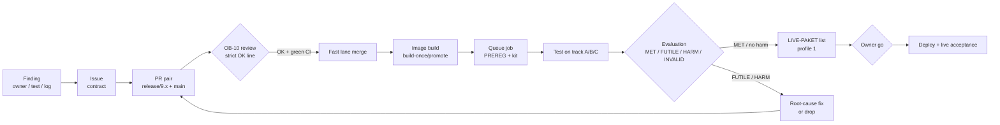
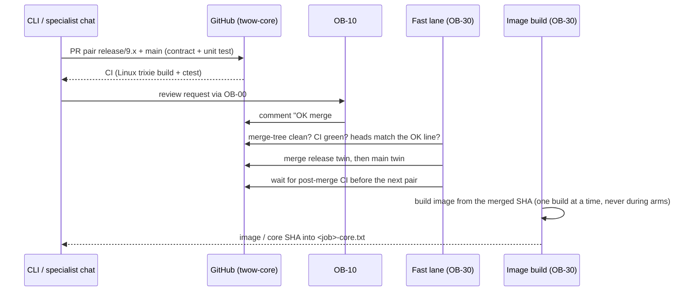
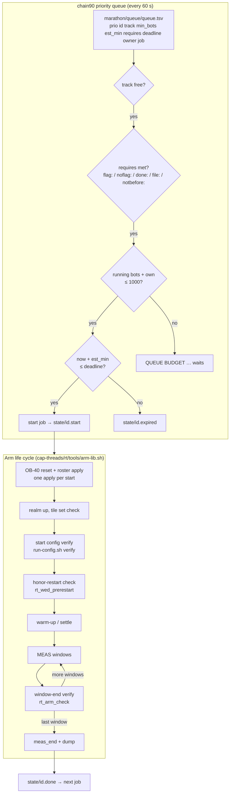
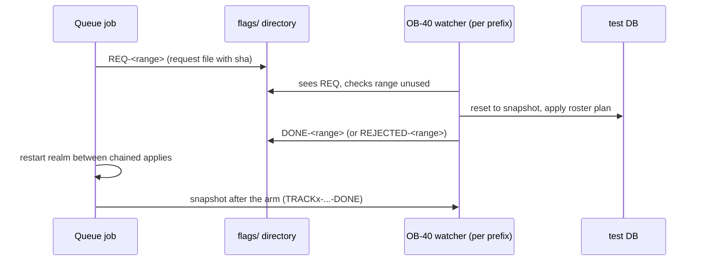
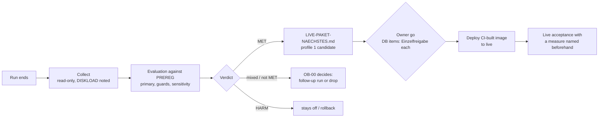

# Runbook: test workflow (fix → test → live)

Status: 2026-10-27, snapshot of the running setup (train 9, priority queue since 2026-10-24).
Owner: OB-00 (rules, priorities, decisions); OB-30 (queue, tracks, images, maintenance);
OB-40 (rosters, resets, snapshots); OB-10 (single merge reviewer); CLIs (fixes, PREREG, evaluation).

This document describes *how* a change travels from a finding to live. The scripts
themselves live under `Y:\tw\builds\ob30-t9-bisect\cap-threads\` (see section 7); this
runbook is the canonical description, the scripts are the implementation.

## 1. Overview

## 2. Rules

| # | Rule | Why |
|---|---|---|
| R1 | Root cause first: observe, read the decision log, fix the cause. No patches around symptoms. | Owner 2026-10-20. Symptom patches hid the grey-quest bug. |
| R2 | Real bug fixes are on by default. Switches exist for A/B and rollback only. | Owner 2026-10-09: "fehler sollten gefixt werden". |
| R3 | Every test has a PREREG before the start: primary measure, guards, early-stop rules (MET / FUTILE / HARM / INVALID). No bending afterwards. | Post-hoc readings produced false wins. abba1 2026-10-27: a maintenance cut fits no stop rule, so the run went to its end. |
| R4 | Only as many bots as the test needs. Machine-wide budget **1000 active bots** (all realms incl. live). Perf/max tests run exclusively, preferably at night. | Owner 2026-10-27. Three realms with 1000 bots each would overload the CPU. |
| R5 | One merge reviewer (OB-10). Merges only on green CI, exact heads and the right `baseRefName`. Twins merge as a pair. | #433 landed on a stale stacked branch. |
| R6 | A test arm runs with a fixed image (`*-core.txt`). New fixes don't sneak into a running comparison. | cand4-B is pinned to a27a4eb3 so it stays comparable with cand4-C. |
| R7 | No builds and no disk-heavy work during perf windows. Behaviour windows note DISKLOAD. | Disk load distorts tick metrics. |
| R8 | Live DB applies, live start and scaling need the owner's Einzelfreigabe directly in the executing chat. | AGENTS overlay §5. |

## 3. Code path: PR to image

Details:
- Pairs that touch `ConfigEcho` are merged serially (the echo list is sorted; parallel pairs conflict).
- New contracts go into their own file under `contracts.d/`.
- SQL PRs also need the bootstrap-from-empty check and a hand merge after the owner's OK.

## 4. Test path: queue, tracks, arm life cycle

Three test realms (tracks **A**, **B**, **C**) share the host. Tests no longer have fixed
slot times: a priority queue dispatches them.

Guards around every arm:

| Guard | What it does | Where |
|---|---|---|
| Commit guard | Waits while Windows commit ≥ 85 GB, alarms after 30 min. One retry on an empty verify. | `arm-lib.sh` |
| Bot budget | A job starts only if running bots + its own `min_bots` ≤ 1000. | `chain90-queue.sh` |
| Heartbeat / alarms | `ALERT IDLE` (track idle > 60 min without `IDLE-OK`), `ALERT DUP` (scheduler running twice), `ALERT COMMIT`. | `chain85c-heartbeat.sh` |
| Hidden launch | Chains start via WMI with `ShowWindow=0`, so they survive app restarts and don't open windows on the owner's desktop. | `hlaunch.ps1` |
| Locale | `LC_ALL=C` in every wrapper (WMI shells inherit de_DE). | chainrun / slot wrappers |

Known slow spot (2026-10-27): `run-config.sh verify` runs one `docker exec` per bind mount
(~142). Under load that takes 30–40 min, once per arm start and again after **every**
window. A batch verify (one `docker exec sha256sum` for all tiles) is next on the list.
The honor-restart check went from ~15–25 min to ~2.5 min on 2026-10-27 (`grep -q` on the
stream, PIPESTATUS-safe under `pipefail`).

## 5. Rosters and resets (OB-40)

- Only one watcher per prefix; same-prefix watchers reject each other's ranges.
- Reset numbers are never reused. A rerun gets a new range.
- Apply slots wait for `<VAR>-DONE` before they end.

## 6. Evaluation to live

Measurement rules:
- Compare rates only within the same roster phase and equal windows.
- Tail metrics (over10/over20/max) are medians over ≥ 10 one-minute windows.
- Interim looks settle ≥ 300 s after the hour mark.
- "Container healthy" is not a behaviour result.

## 7. Where things live

| Thing | Path |
|---|---|
| Queue | `Y:\tw\builds\ob30-t9-bisect\cap-threads\marathon\queue\queue.tsv`, state in `…\queue\state\` |
| Scheduler | `…\cap-threads\chain90-queue.sh` (with bot budget) |
| Heartbeat | `…\cap-threads\chain85c-heartbeat.sh` |
| Arm library | `…\cap-threads\rt\tools\arm-lib.sh` |
| Flags A / B | `…\ob30-t9-bisect\cap-threads\flags`, `…\ob30-t9b\cap-threads\flags` |
| Fast lane / hidden launch | `…\cap-threads\marathon\fastlane-runner.sh`, `…\cap-threads\marathon\hlaunch.ps1` (OB-30) |
| Review queue | `Y:\tw\evidence\ws-10\REVIEW-QUEUE-OB10.md` |
| Live package list | `Y:\tw\evidence\ws-00\LIVE-PAKET-NAECHSTES.md` |
| Run results | per CLI under `Y:\tw\evidence\<ws>\…`, with `SHA256SUMS` |

Open: the scripts are not in this repo yet. Moving them in (after a secrets check) is a separate OB-30 task.
